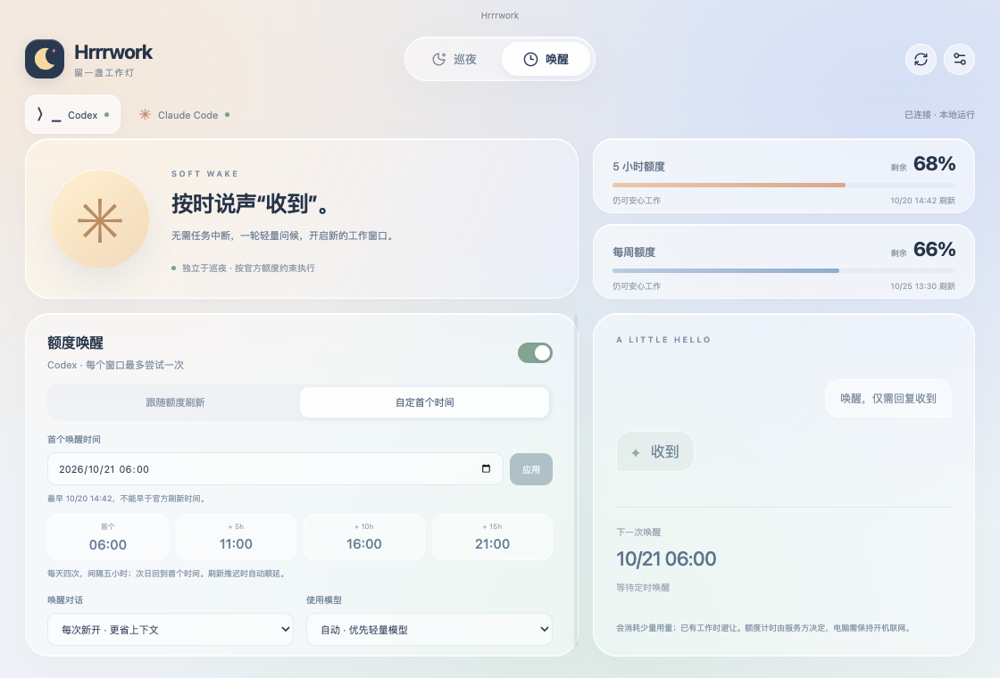

<div align="center">
  
  <h1>Hrrrwork 2.0</h1>
  <p><strong>你去睡，留一盏工作灯。</strong></p>
  <p>巡夜接住中断的任务，唤醒按你的时间轻轻问候。</p>

  [官网](https://choneychen.github.io/Hrrrwork/) · [下载](https://github.com/ChoneyChen/Hrrrwork/releases/latest) · [更新记录](CHANGELOG.md)
</div>


## 两个功能，各自值班

| 功能 | 触发条件 | 行为 |
|---|---|---|
| 巡夜 | 任务因五小时 / 每周额度耗尽而中断 | 等到官方刷新，检查原轮次，向原任务发 `continue` |
| 唤醒 | 可选开启，不要求任务中断 | 向新对话或指定空闲对话发 `唤醒，仅需回复收到` |

开关相互独立；关闭巡夜不会关闭唤醒。数字与进度条均表示**剩余额度**，未知时显示「—」。

监测连接只读，不接管对话或读取正文。实际发送使用独立进程，结束或需要授权时释放会话；执行期间由该进程持有对话。刷新时直接复查并续跑，默认不额外等待；官方额度仍未释放时约每 5 秒复查。可在「续跑偏好」另选缓冲时间，发送前仍核对额度与原轮次，结果未知不自动重发。

## 自定首个唤醒时间



默认跟随官方五小时刷新。也可在「唤醒 → 自定首个时间」中选择日期和时间，再点击应用：

- 每天四次，间隔五小时。如 `06:00 → 11:00 → 16:00 → 21:00 → 次日 06:00`。
- 若官方下一次刷新为 06:30，首个时间不能早于 06:30；界面和后台均校验。
- 运行中官方刷新推迟或周额度阻塞时顺延，不提前发送。时区使用本机时区。
- 已有工作时避让，每个官方窗口最多尝试一次；失败或结果未知时不盲目重发。
- 默认新开专用对话，优先已知轻量模型，也可选模型及空闲对话。

唤醒会消耗少量用量，不保证“锁定”窗口或免费；计量、起算和模型权限由服务方决定。电脑需开机联网，休眠期间无法执行，错过过久的计划不集中补发。

## 安装与连接

支持 **macOS / Windows x64 / Linux x64**，前往[官网下载](https://choneychen.github.io/Hrrrwork/#download)。

- Mac：Apple Silicon / Intel 分别提供原生 DMG。Universal 包保留给旧版自动更新兼容。
- Windows：使用安装版 EXE，支持更新安装，不再以便携版为主。
- Ubuntu / Debian：安装 DEB；其他 Linux 可运行 AppImage。

先安装并登录 Codex 或 Claude Code。Codex 自动发现桌面内置 CLI、DEB 资源、同用户运行进程及常见 Node 安装目录；可在设置中指定路径。Claude Code 点击「连接」，下一轮会话同步额度；保留原状态栏和 hooks，断开时恢复。

## 更新与瘦身

启动后和每六小时检查 GitHub 正式版，自动下载并核验 SHA-256，可分别关闭检查 / 下载。下载完成后点击**关闭并安装**：退出应用，启动系统安装流程，需要权限时由系统询问。新版成功启动且版本、位置匹配后，自动删除本工具缓存中的安装包。取消或失败时保留以便重试，不清理用户自行下载的其他文件。

移除前端重复依赖、多余语言资源，压缩构建输出，Mac 按架构分包。Electron 运行时仍是包体主要部分。旧版第一次升级到 2.0 使用旧版安装入口，此后可用「关闭并安装」。配置和接力记录沿用原数据目录。

## 命令行下载

macOS Apple Silicon（Intel 将 `arm64` 改为 `x64`）：

```bash
curl -fL 'https://github.com/ChoneyChen/Hrrrwork/releases/download/v2.0.3/Hrrrwork-2.0.3-mac-arm64.dmg' -o Hrrrwork.dmg
```

Windows PowerShell：

```powershell
Invoke-WebRequest -Uri 'https://github.com/ChoneyChen/Hrrrwork/releases/download/v2.0.3/Hrrrwork-2.0.3-win-x64.exe' -OutFile Hrrrwork-Setup.exe
```

Ubuntu / Debian：

```bash
curl -fL 'https://github.com/ChoneyChen/Hrrrwork/releases/download/v2.0.3/Hrrrwork-2.0.3-linux-amd64.deb' -o Hrrrwork.deb
sudo apt install ./Hrrrwork.deb
```

## 开发

Node.js 24+，`npm ci` 后运行：

```bash
npm run dev           # 本地开发
npm run check         # 类型、单测、构建
npm run package:mac   # 原生分包 + 旧版兼容包
npm run package:win   # Windows 安装程序
npm run package:linux # DEB / AppImage
```

GitHub Actions 在原生系统上验证定时规则、安装器及打包内容，`v*` 标签生成 Release。不重复打包开发依赖、测试与 source maps。安全边界见 [SECURITY.md](SECURITY.md)，发现漏洞请使用 GitHub 私密安全报告，不公开粘贴账号数据。

MIT · 不隶属于 OpenAI 或 Anthropic。
