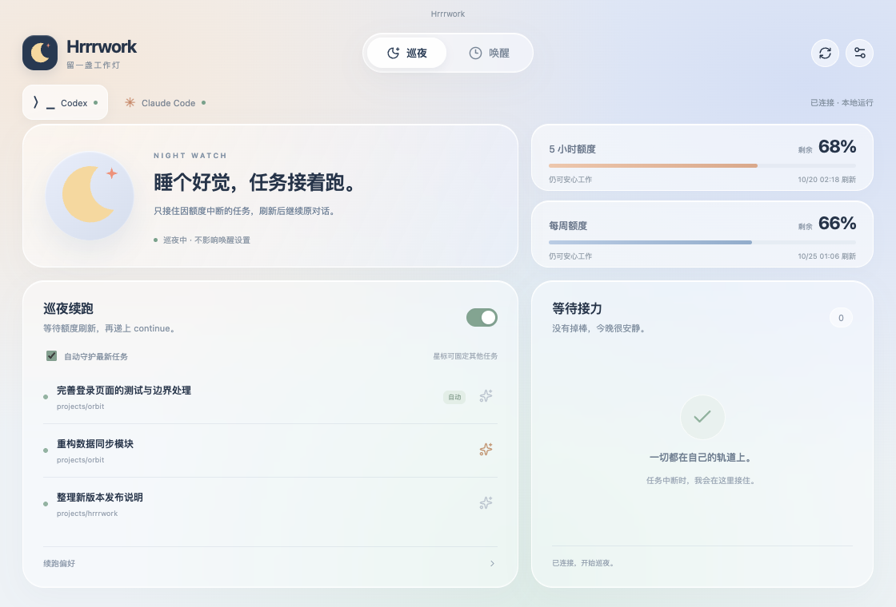
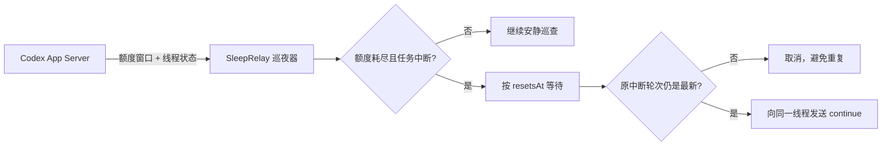

<div align="center">
  
  <h1>SleepRelay · 睡眠接力</h1>
  <p><strong>你去睡，任务别停。</strong></p>
  <p>当 Codex 因 5 小时 / 每周额度耗尽而中断，SleepRelay 会安静等到额度刷新，再把 <code>continue</code> 递回原任务。</p>

  [](#安装)
  [](#安装)
  [](#安装)
  [](https://github.com/ChoneyChen/SleepRelay/actions/workflows/check.yml)
  [](LICENSE)
</div>



## 它做什么

SleepRelay 是一个很小的跨平台桌面巡夜员。它使用 Codex 官方本地 App Server 协议，不抓屏、不模拟点击，也不碰浏览器 Cookie。

1. 定时读取 Codex 的 5 小时与每周额度窗口；
2. 额度真正耗尽时，确认最近任务是否以 `interrupted` / `failed` 状态结束；
3. 精确等待官方返回的 `resetsAt`，再留出一小段缓冲；
4. 发送前重新检查原任务——如果你已经手动继续，它会自动取消；
5. 任务仍停在原中断轮次时，向同一线程发送 `continue`。

> 官方协议参考：[Codex App Server](https://developers.openai.com/codex/app-server)。SleepRelay 是社区工具，并非 OpenAI 官方产品。

## 设计上的小心思

- **不靠猜时间**：直接读取 5 小时 / 每周窗口的真实刷新时间。
- **两道防重复保护**：额度必须确实耗尽；发送前必须仍是同一条中断轮次。
- **默认保守**：自动守护最近的中断任务；也可以给多个重要任务点亮星标。
- **本地优先**：配置、接力篮与简短事件记录只保存在本机，不保存账号令牌。
- **三端一致**：macOS、Windows、Linux 使用同一套 UI 与核心逻辑，并各自支持开机启动。
- **托盘常驻**：关掉主窗口后继续静默巡夜，真正需要时才通知。

## 安装

### 下载应用

前往 [Releases](https://github.com/ChoneyChen/SleepRelay/releases) 下载对应系统的安装包：

| 系统 | 文件 |
|---|---|
| macOS | `.dmg` 或 `.zip` |
| Windows | 便携版 `.exe` |
| Linux | `.AppImage` 或 `.deb` |

> 当前首发包是未做商业证书签名的社区构建。macOS 首次打开时可在 Finder 中右键应用选择「打开」；Windows 若显示 SmartScreen，可先核对下载来源确为本仓库，再选择「仍要运行」。

### 前置条件

- 已安装并登录 ChatGPT/Codex 桌面端，或已安装并登录 [Codex CLI](https://learn.chatgpt.com/docs/codex-cli)；
- SleepRelay 通常会自动找到桌面端内置或系统中的 `codex`；找不到时可在「巡夜设置」中手动填写路径。

首次打开后，保持「自动接力」开启即可。想守护多个任务时，在「最近任务」右侧点亮星标。

## 工作原理



核心由四层组成：

```text
src/main/codex/   官方 App Server 连接与跨平台路径发现
src/main/relay/   额度判断、任务筛选、队列与防重复逻辑
src/main/         Electron 生命周期、托盘、开机启动与本地存储
src/renderer/     React 可视化界面
```

## 本地开发

需要 Node.js 24+。

```bash
git clone https://github.com/ChoneyChen/SleepRelay.git
cd SleepRelay
npm install
npm run dev
```

常用命令：

```bash
npm run check          # 类型检查 + 单元测试 + 生产构建
npm run package:mac    # macOS 安装包
npm run package:win    # Windows 安装包
npm run package:linux  # Linux 安装包
```

跨平台安装包由 GitHub Actions 在各自原生系统上构建。推送 `v*` 标签会自动生成 Release；也可在 Actions 中手动运行构建并下载三端 artifacts。

## 安全与边界

- SleepRelay 只通过本机 `codex app-server` 通信，沿用你已有的 Codex 登录；
- 不上传对话、配置或令牌到第三方服务器；
- 事件日志仅记录“连接、发现中断、接力成功/失败”等摘要，不记录对话正文；
- 自动发送仅限你开启守护的范围，且内容默认为 `continue`；
- Codex 协议或桌面端存储行为未来若变化，SleepRelay 会显示连接错误，而不是降级为模拟鼠标键盘。

发现安全问题请不要公开贴出账号数据或线程内容，可通过仓库的 Security advisory 私下报告。

## 路线图

- [x] 5 小时 / 周额度识别
- [x] 原线程精确续跑与重复发送保护
- [x] macOS / Windows / Linux
- [x] 托盘、通知、开机启动、任务星标
- [ ] 更多语言
- [ ] 可选的接力统计卡片

## License

[MIT](LICENSE) · 做个好梦，剩下的交给接力员。🌙
