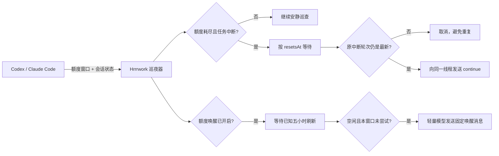

<div align="center">
  
  <h1>Hrrrwork · 睡眠接力</h1>
  <p><strong>你去睡，任务别停。</strong></p>
  <p>额度中断时接力，空闲时轻量唤醒。为 Codex / Claude Code 留一盏小小的工作灯。</p>

  [](#安装)
  [](#安装)
  [](#安装)
  [](https://github.com/ChoneyChen/Hrrrwork/actions/workflows/check.yml)
  [](LICENSE)

  [访问官网](https://choneychen.github.io/Hrrrwork/) · [下载 Hrrrwork](https://github.com/ChoneyChen/Hrrrwork/releases/latest)
</div>


## 它做什么

Hrrrwork 为 Codex 和 Claude Code 值夜班。自动检测本机应用，按应用显示额度、连接状态与任务；窗口固定贴合边框，内容只在列表内部滚动。

| 模式 | 什么时候发送 | 发送内容 |
|---|---|---|
| 中断接力 | 额度耗尽且原任务中断，等待刷新后 | 向原任务发送 `continue` |
| 额度唤醒 · 可选 | 即使任务未中断、额度未用完，也在已知五小时窗口刷新后 | 向新对话或指定空闲对话发送 `唤醒，仅需回复收到` |

### 中断接力

1. 同步各应用的 5 小时与每周额度窗口；
2. 额度真正耗尽时，确认最近任务是否以 `interrupted` / `failed` 状态结束；
3. 精确等待官方返回的 `resetsAt`，再留出一小段缓冲；
4. 发送前重新检查原任务——如果你已经手动继续，它会自动取消；
5. 任务仍停在原中断轮次时，向同一线程发送 `continue`。

| 应用 | 额度与中断识别 | 接力方式 |
|---|---|---|
| Codex | 本地 App Server 读取额度与中断轮次 | 向原线程发送消息 |
| Claude Code | 官方状态栏 `rate_limits` + `StopFailure: rate_limit` | CLI 按原 session ID 继续 |

协议参考：[Codex App Server](https://developers.openai.com/codex/app-server)、[Claude Code 状态栏](https://code.claude.com/docs/en/statusline)、[Hooks](https://code.claude.com/docs/en/hooks)、[继续会话](https://code.claude.com/docs/en/headless#continue-conversations)。

## 设计上的小心思

- **不靠猜时间**：直接读取 5 小时 / 每周窗口的真实刷新时间。
- **两道防重复保护**：额度必须确实耗尽；发送前必须仍是同一条中断轮次。
- **默认保守**：自动守护最近的中断任务；也可以给多个重要任务点亮星标。
- **本地优先**：配置、接力篮与简短事件记录只保存在本机，不保存账号令牌。
- **三端一致**：macOS、Windows、Linux 使用同一套 UI 与核心逻辑，并各自支持开机启动。
- **托盘常驻**：关掉主窗口后继续静默巡夜，真正需要时才通知。
- **更新也省心**：三端自动检查与下载正式版本，SHA-256 校验后提示安装。

## 安装

### 下载应用

前往 [Hrrrwork 官网](https://choneychen.github.io/Hrrrwork/#download) 下载对应系统的安装包：

| 系统 | 文件 |
|---|---|
| macOS | `.dmg` 或 `.zip` |
| Windows | 便携版 `.exe` |
| Linux | `.AppImage` 或 `.deb` |


### 前置条件

- 安装并登录你使用的 Codex 或 Claude Code；Claude Code 需使用支持 `rate_limits` 状态栏和 `StopFailure` hook 的新版。
- Hrrrwork 自动发现桌面端内置 / PATH / 常见安装目录中的可执行文件，也可在设置中填写路径。

首次打开后，保持「自动接力」开启即可。想守护多个任务时，在「最近任务」右侧点亮星标。

### 自动检查与下载更新

v1.2 起，macOS、Windows、Linux 默认在启动后及每 6 小时检查 GitHub 正式发布，发现新版本后自动下载对应安装包。设置 → 软件更新可分别关闭自动检查、自动下载，也可随时手动检查。

- Mac 下载 Universal DMG；Windows x64 下载便携 EXE；Ubuntu / Debian 下载 DEB；AppImage 启动时仍下载 AppImage，其他 Linux x64 选择 AppImage。没有匹配架构的发布包时明确提示，不下载错误架构。
- 按 GitHub 发布资产的 SHA-256 与文件大小校验，下载未完成或校验失败时不提供安装入口；打开更新包前再次校验。
- 下载完成后点击「查看更新包」。从托盘退出旧版，再在 Mac 拖入应用程序、Windows 打开新版 EXE、Ubuntu 安装 DEB，或替换 AppImage 并设为可执行。不会静默覆盖正在运行的应用，也不会自行提权。
- 设置和接力记录沿用原数据目录。GitHub 无法访问或请求受限时显示重试，不影响原有巡夜。
- v1.1 及更早版本需要先手动升级到 v1.2，之后才能使用内置更新。

### Ubuntu DEB 自动发现

支持 Codex 桌面端位于 `/usr/lib/chatgpt` 等目录时，从内置资源找到 CLI，而非误把 GUI 当作命令行启动。也会检查同用户正在运行的 Codex 进程、PATH 以及 npm / nvm / fnm / asdf 等常见目录。图形桌面 PATH 中没有 Node 时，Node 入口改用应用自带运行时启动。

运行进程有 `CODEX_HOME` / `CODEX_SQLITE_HOME` 时，只继承这两个位置设置以连接同一数据目录，不复制或记录其余环境变量。设置中可查看发现来源、CLI 路径与数据目录；必要时清空旧的手动路径后点击「应用」，再重新检查。额度接口暂时失败不会隐藏已同步的任务，错误分别显示。

### 连接 Claude Code

切换到 Claude Code，点击「连接 Claude Code」。下一轮会话开始后，状态栏和事件桥接会同步额度与中断状态。连接时会备份设置，保留原状态栏及已有 hooks；点击「断开」会移除本工具的桥接并恢复原状态栏。

只有明确的额度错误与已知刷新时间会安排接力，缺少额度信息时显示等待。手动继续会使旧接力失效。接力使用本机 CLI 和原会话 ID，沿用 Claude 的权限设置；需要批准时请打开原会话处理。

### 额度唤醒

v1.1 新增，两个应用可分别开启，与「自动接力」独立运行，新安装与升级后均默认关闭。

1. 打开设置中的「额度唤醒」，选择 Codex 或 Claude Code；
2. 开启对应应用的唤醒开关；
3. 默认每次新开专用对话，以减少历史上下文。也可选一个已有的空闲对话；
4. 模型默认「自动 · 优先轻量模型」，也可自行选择；
5. 保持应用后台运行，主界面会显示唤醒计划。

固定消息是 **“唤醒，仅需回复收到”**。按已知的官方五小时 `resetsAt` 加设置中的缓冲等待，不要求任务中断或用量达到 100%。这里的刷新指官方报告的额度窗口重置，并非要求“已使用 100%”。

Codex 从本机 `model/list` 中优先选择 GPT-6 Luna，再选择 GPT-5.6 Luna，并使用该模型支持的最低推理档位和标准速度；没有已知轻量模型时等待用户选择，不自动切换到更贵的模型。Claude Code 默认使用 `haiku` 别名，可选 Sonnet、Opus 或填写完整模型 ID；实际模型可用性与别名映射以本机客户端和账号策略为准。[Codex 模型与档位](https://learn.chatgpt.com/docs/app-server#models)、[官方额度／积分说明](https://learn.chatgpt.com/docs/pricing)、[Claude 模型配置](https://code.claude.com/docs/en/model-config)。

保护措施：

- 每个官方五小时刷新时间最多尝试一次，发送记录在发起前持久化；重启、超时或结果不确定时不盲目重发。
- 已有工作或接力时不打扰；已用完的周额度会顺延，超过计划 30 分钟的旧唤醒不补发。
- 若官方已报告新窗口且有用量，跳过多余唤醒；下一次只根据新报告的真实刷新时间安排，不自行假设“当前时间 + 5 小时”。
- 选择已有对话会新增消息、携带历史上下文，并可能改变该对话后续使用的模型；新对话更省用量。
- 唤醒本身会消耗少量用量，不保证免费、恰好恢复 100% 或“锁定”五小时窗口。不同模型可能使用不同计量桶，唤醒一个模型不保证其他模型的窗口起算。实际起算、额度和费用由服务方决定；缺少刷新时间时等待同步。

### 命令行下载

macOS：

```bash
curl -fL 'https://github.com/ChoneyChen/Hrrrwork/releases/download/v1.2.0/Hrrrwork-1.2.0-mac-universal.dmg' -o Hrrrwork.dmg
```

Windows PowerShell：

```powershell
Invoke-WebRequest -Uri 'https://github.com/ChoneyChen/Hrrrwork/releases/download/v1.2.0/Hrrrwork-1.2.0-win-x64.exe' -OutFile Hrrrwork.exe
```

Linux：

```bash
curl -fL 'https://github.com/ChoneyChen/Hrrrwork/releases/download/v1.2.0/Hrrrwork-1.2.0-linux-x86_64.AppImage' -o Hrrrwork.AppImage
chmod +x Hrrrwork.AppImage
```

## 工作原理



核心由以下几层组成：

```text
src/main/codex/   官方 App Server 连接与跨平台路径发现
src/main/providers/ Claude Code、应用发现与跨平台启动
src/main/relay/   额度判断、任务筛选、队列与防重复逻辑
src/main/updates/ 正式版检查、平台匹配、下载与完整性校验
src/main/         Electron 生命周期、托盘、开机启动与本地存储
src/renderer/     React 可视化界面
```

## 本地开发

需要 Node.js 24+。

```bash
git clone https://github.com/ChoneyChen/Hrrrwork.git
cd Hrrrwork
npm install
npm run dev
```

常用命令：

```bash
npm run check          # 类型检查 + 单元测试 + 生产构建
npm run package:mac    # macOS 安装包
npm run package:win    # Windows 安装包
npm run package:linux  # Linux 安装包
```

跨平台安装包由 GitHub Actions 在各自原生系统上构建。推送 `v*` 标签会自动生成 Release；也可在 Actions 中手动运行构建并下载三端 artifacts。

## 安全与边界

- Hrrrwork 通过本地协议或状态栏 / 事件桥接同步，沿用编码助手的已有登录；
- 不上传对话、配置或令牌到第三方服务器；
- 事件日志仅记录“连接、发现中断、接力成功/失败”等摘要，不记录对话正文；
- 自动发送仅限你开启守护的范围，且内容默认为 `continue`；
- 可选的额度唤醒默认关闭，开启后会发送固定短消息；不消耗任何额度重置券，也不绕过服务方限制；
- 软件更新仅联系官方 GitHub 仓库，发送版本检查与安装包下载请求，不携带对话或登录令牌；自动下载默认开启，可在设置关闭；
- 额度数据缺失、权限待批准或接口变化时，界面会显示等待或需要检查。

发现安全问题请不要公开贴出账号数据或线程内容，可通过仓库的 Security advisory 私下报告。

## 路线图

- [x] 5 小时 / 周额度识别
- [x] 原线程精确续跑与重复发送保护
- [x] macOS / Windows / Linux
- [x] 托盘、通知、开机启动、任务星标
- [x] Claude Code 检测、额度同步与原会话接力
- [x] 固定窗口布局与列表内滚动
- [x] 三平台命令行下载
- [x] 独立额度唤醒、新对话 / 指定对话、轻量模型选择
- [x] 三端自动检查更新、后台下载与 SHA-256 校验
- [x] Ubuntu DEB / 运行进程 / Node 版本管理器发现
- [ ] 更多语言
- [ ] 可选的接力统计卡片

## License

[MIT](LICENSE) · 做个好梦，剩下的交给接力员。🌙
