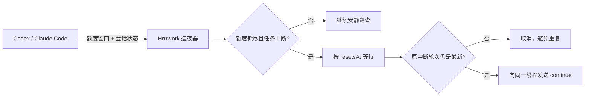

<div align="center">
  
  <h1>Hrrrwork · 睡眠接力</h1>
  <p><strong>你去睡，任务别停。</strong></p>
  <p>当 Codex / Claude Code 因 5 小时或每周额度中断，Hrrrwork 等到刷新，再把 <code>continue</code> 递回原任务。</p>

  [](#安装)
  [](#安装)
  [](#安装)
  [](https://github.com/ChoneyChen/Hrrrwork/actions/workflows/check.yml)
  [](LICENSE)

  [访问官网](https://choneychen.github.io/Hrrrwork/) · [下载 Hrrrwork](https://github.com/ChoneyChen/Hrrrwork/releases/latest)
</div>


## 它做什么

Hrrrwork 为 Codex 和 Claude Code 值夜班。自动检测本机应用，按应用显示额度、连接状态与任务；窗口固定贴合边框，内容只在列表内部滚动。

1. 同步各应用的 5 小时与每周额度窗口；
2. 额度真正耗尽时，确认最近任务是否以 `interrupted` / `failed` 状态结束；
3. 精确等待官方返回的 `resetsAt`，再留出一小段缓冲；
4. 发送前重新检查原任务——如果你已经手动继续，它会自动取消；
5. 任务仍停在原中断轮次时，向同一线程发送 `continue`。

| 应用 | 额度与中断识别 | 接力方式 |
|---|---|---|
| Codex | 本地 App Server 读取额度与中断轮次 | 向原线程发送消息 |
| Claude Code | 官方状态栏 `rate_limits` + `StopFailure: rate_limit` | CLI 按原 session ID 继续 |

协议参考：[Codex App Server](https://developers.openai.com/codex/app-server)、[Claude Code 状态栏](https://code.claude.com/docs/en/statusline)、[Hooks](https://code.claude.com/docs/en/hooks)、[继续会话](https://code.claude.com/docs/en/headless#continue-conversations)。

## 设计上的小心思

- **不靠猜时间**：直接读取 5 小时 / 每周窗口的真实刷新时间。
- **两道防重复保护**：额度必须确实耗尽；发送前必须仍是同一条中断轮次。
- **默认保守**：自动守护最近的中断任务；也可以给多个重要任务点亮星标。
- **本地优先**：配置、接力篮与简短事件记录只保存在本机，不保存账号令牌。
- **三端一致**：macOS、Windows、Linux 使用同一套 UI 与核心逻辑，并各自支持开机启动。
- **托盘常驻**：关掉主窗口后继续静默巡夜，真正需要时才通知。

## 安装

### 下载应用

前往 [Hrrrwork 官网](https://choneychen.github.io/Hrrrwork/#download) 下载对应系统的安装包：

| 系统 | 文件 |
|---|---|
| macOS | `.dmg` 或 `.zip` |
| Windows | 便携版 `.exe` |
| Linux | `.AppImage` 或 `.deb` |


### 前置条件

- 安装并登录你使用的 Codex 或 Claude Code；Claude Code 需使用支持 `rate_limits` 状态栏和 `StopFailure` hook 的新版。
- Hrrrwork 自动发现桌面端内置 / PATH / 常见安装目录中的可执行文件，也可在设置中填写路径。

首次打开后，保持「自动接力」开启即可。想守护多个任务时，在「最近任务」右侧点亮星标。

### 连接 Claude Code

切换到 Claude Code，点击「连接 Claude Code」。下一轮会话开始后，状态栏和事件桥接会同步额度与中断状态。连接时会备份设置，保留原状态栏及已有 hooks；点击「断开」会移除本工具的桥接并恢复原状态栏。

只有明确的额度错误与已知刷新时间会安排接力，缺少额度信息时显示等待。手动继续会使旧接力失效。接力使用本机 CLI 和原会话 ID，沿用 Claude 的权限设置；需要批准时请打开原会话处理。

### 命令行下载

macOS：

```bash
curl -fL 'https://github.com/ChoneyChen/Hrrrwork/releases/download/v1.0.0/Hrrrwork-1.0.0-mac-universal.dmg' -o Hrrrwork.dmg
```

Windows PowerShell：

```powershell
Invoke-WebRequest -Uri 'https://github.com/ChoneyChen/Hrrrwork/releases/download/v1.0.0/Hrrrwork-1.0.0-win-x64.exe' -OutFile Hrrrwork.exe
```

Linux：

```bash
curl -fL 'https://github.com/ChoneyChen/Hrrrwork/releases/download/v1.0.0/Hrrrwork-1.0.0-linux-x86_64.AppImage' -o Hrrrwork.AppImage
chmod +x Hrrrwork.AppImage
```

## 工作原理



核心由四层组成：

```text
src/main/codex/   官方 App Server 连接与跨平台路径发现
src/main/providers/ Claude Code、应用发现与跨平台启动
src/main/relay/   额度判断、任务筛选、队列与防重复逻辑
src/main/         Electron 生命周期、托盘、开机启动与本地存储
src/renderer/     React 可视化界面
```

## 本地开发

需要 Node.js 24+。

```bash
git clone https://github.com/ChoneyChen/Hrrrwork.git
cd Hrrrwork
npm install
npm run dev
```

常用命令：

```bash
npm run check          # 类型检查 + 单元测试 + 生产构建
npm run package:mac    # macOS 安装包
npm run package:win    # Windows 安装包
npm run package:linux  # Linux 安装包
```

跨平台安装包由 GitHub Actions 在各自原生系统上构建。推送 `v*` 标签会自动生成 Release；也可在 Actions 中手动运行构建并下载三端 artifacts。

## 安全与边界

- Hrrrwork 通过本地协议或状态栏 / 事件桥接同步，沿用编码助手的已有登录；
- 不上传对话、配置或令牌到第三方服务器；
- 事件日志仅记录“连接、发现中断、接力成功/失败”等摘要，不记录对话正文；
- 自动发送仅限你开启守护的范围，且内容默认为 `continue`；
- 额度数据缺失、权限待批准或接口变化时，界面会显示等待或需要检查。

发现安全问题请不要公开贴出账号数据或线程内容，可通过仓库的 Security advisory 私下报告。

## 路线图

- [x] 5 小时 / 周额度识别
- [x] 原线程精确续跑与重复发送保护
- [x] macOS / Windows / Linux
- [x] 托盘、通知、开机启动、任务星标
- [x] Claude Code 检测、额度同步与原会话接力
- [x] 固定窗口布局与列表内滚动
- [x] 三平台命令行下载
- [ ] 更多语言
- [ ] 可选的接力统计卡片

## License

[MIT](LICENSE) · 做个好梦，剩下的交给接力员。🌙
